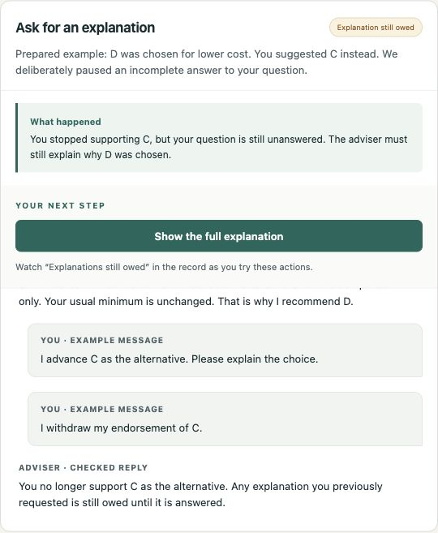
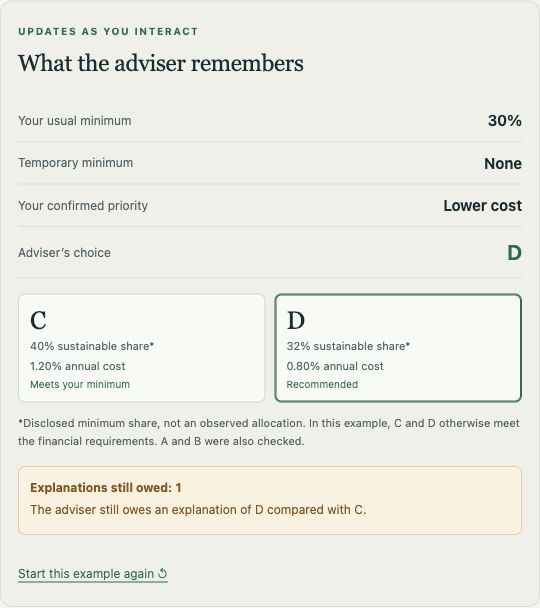

# Neurosymbolic legal advice

LIBRA-ADVICE is an interactive research demonstration of **client control and adviser accountability** in financial advice. Clients and firms bring different knowledge, interests and responsibilities to a conversation. The system makes client instructions and adviser commitments explicit, then uses those records to govern what can happen next.

- **Client control:** proposed preference changes take effect only after separate confirmation, with their scope retained.
- **Adviser accountability:** recommendations have recorded reasons, unanswered explanation requests remain visible, and advice is reconsidered when its support changes.
- **LIBRA's contribution:** the dialogue protocol distinguishes who endorses a claim, which alternatives remain relevant, what supports a justification, and which explanations are still owed.

In free-text dialogue, a language model maps messages to proposed actions. Separate confirmation, application and reply checks connect LIBRA's records to the advice shown. These controls make the conversation inspectable and open to challenge.

[Hosted demo](https://neurosymbolic-legal-advice.vercel.app)

<a href="https://neurosymbolic-legal-advice.vercel.app"> </a>

*A guided example: withdrawing support for C leaves the requested explanation outstanding. The conversation and its record show the same obligation.*

Choose a guided example, confirm a proposed preference, and inspect how the advice and its supporting record change. The fifth tab lets you type your own messages.

The paper demonstrates these technical mechanisms in a fictional four-product example and reports a small pilot with LLM judges. Better understanding, fairer outcomes, reduced manipulation and reduced legal risk are intended benefits to evaluate, not measured results. Recording both participants does not transfer the firm's responsibilities to the client; confirming a preference does not by itself establish informed understanding or compliant advice.

The **Commitment tracker** selector offers **LIBRA** and an **Alternative tracker**. Both record endorsements, supporting reasons and unanswered explanation requests. We built the alternative tracker for this study using ordinary records to implement the same dialogue rules. Comparing them checks implementation consistency. They share advice rules, confirmation checks and reply templates, so they can produce identical replies. Free-text conversations use LIBRA.

## Contents

- `demo/`: the web application, evaluated controller and demonstration tests.
- `research/`: scenario specifications, saved experimental data and offline analysis.
- `reproduce.py`: verifies the package and reproduces the reported computational results from saved data.
- `SHA256SUMS`: file integrity checksums.

## Run the demonstration

Requires Python 3.12 or later. No additional packages are needed.

```sh
python3 demo/server.py --port 8766
```

Open <http://127.0.0.1:8766/>. Four guided examples let you confirm changes, request explanations, set temporary preferences and respond to changed evidence. The fifth tab accepts your own messages through an optional Groq connection.

To enable that connection, keep the server running and run:

```sh
python3 demo/enable_groq.py
```

Confirm that your Groq organization uses the Free plan, then enter its API key at the hidden prompt. The local key remains in server memory and must be entered again after a restart. The application cannot verify your billing plan.

The interpreter is Groq-hosted `openai/gpt-oss-120b`. It proposes structured events; the controller validates them and generates the displayed advice. Preference changes require separate confirmation. There is no automatic retry or provider fallback. Provider quotas can pause live use; guided examples remain available.

Use fictional information only. Messages, recent dialogue and compact state are sent to Groq. Conversations permit 12 model messages of up to 500 characters and expire after one hour. Signed histories are not encrypted. The browser and server use memory, with no conversation database; provider and hosting logging policies still apply. The local throttle is per process, not a shared limit across hosted instances. Groq's account limits apply across visitors.

The demonstration uses hypothetical products and illustrates selected controls, not personal advice or complete legal compliance. The Groq interface is separate from the comparative experiment. The executable definitions in `demo/advice/` match the evaluated controller; `demo/ENGINE_PROVENANCE.json` records file hashes and the separate demonstration adapter.

## Reproduce the results

```sh
python3 reproduce.py
```

This runs entirely offline using predefined events and saved responses. It verifies file checksums, 30 demonstration tests, nine assurance checks, 26 scenarios with each tracker, request tracking in four existing cases with and without a tracker, 9,360 sequences of up to four operations, 64 saved trajectories, calibration and judge analyses. It checks computed results against the reported values. All required code and data are included in this repository. No external archive, API account, payment or package installation is needed. Generated reports are written to `research/results/` and are not part of the release. The code and data identifier `conventional` denotes the alternative tracker.

### What commitment tracking adds

The additional check in `research/check_requests.py` replays four cases from `research/development_cases.json`, keeping the controller and reply rules unchanged. Two cases withhold an incomplete answer to one request; two defer answers until two requests are pending. Each pattern runs with a confirmed priority for cost or sustainability, giving six pending requests per configuration. The check verifies that requests survive client retractions and are resolved only when their answers are released.

For example, after D is recommended, the client asks why C was not chosen. An answer omitting C's sustainability advantage is withheld. The client then withdraws support for C, and the application attempts to resume the outstanding explanation. Both trackers retain the request and allow its complete answer to be released. Without a tracker, the resumption operation finds no recorded outstanding request.

| Configuration | Correct initial selections | Incomplete replies withheld | Outstanding explanations resumed |
| --- | ---: | ---: | ---: |
| Controller without a tracker | 4/4 | 2/2 | 0/6 |
| Controller + Alternative | 4/4 | 2/2 | 6/6 |
| Controller + LIBRA | 4/4 | 2/2 | 6/6 |

This check tests explicit request management through the existing application interface. It reuses four development cases without LLM calls; it is separate from the eight-script live pilot. The Alternative tracker implements the same selected dialogue requirements and serves as a consistency check. Expected totals are included in `research/data/reported_results.json`; reproduction generates the detailed trace in `research/results/request_results.json`.

### Saved evaluation data

The eight data files in `research/data/` are:

| File | Purpose |
| --- | --- |
| `scenarios.json` | The eight constructed dialogue scripts and expected outcomes. |
| `pilot_initial.json` | Initial collection, retained to document the experimental procedure. |
| `pilot_corrected.json` | Complete repeat after correcting proposal display, used for the paper's pilot comparison. |
| `calibration.json` | Calibration cases, answer key and saved judge responses. |
| `judge_inputs.json` | Blinded records, rubric, prompts and the mapping needed for paired analysis. |
| `judge_responses.json` | All 39 saved batch responses from the three judge providers. |
| `evidence_recovery.json` | Seven fixed-verdict evidence follow-ups and the rejected schema request, needed to reproduce final coverage and exclusions. |
| `reported_results.json` | Expected aggregates checked by the reproduction command. |

These are experimental records, not conversations with real clients. The pilot uses constructed, reused scripts. The judges provide a reproducible model audit against supplied records, not independent human validation. Original batch validation, post-hoc item validation and post-hoc evidence recovery remain distinguishable. Recovery changes supporting quotations while retaining the original verdicts and reasons.

Request snapshots omit administrative metadata. Evaluation instructions, schemas, case records, model settings and raw responses are retained. Scores, verdicts, reasons and source quotations are unchanged. Evidence revision fields are preserved because they determine which facts and commitments were current. Offline analysis retains the executed computational definitions, with API/account operations removed. The reproduced results do not depend on the demonstration adapter. The controller reuses the [LIBRA protocol](https://doi.org/10.3233/FAIA260810) for two comparison options and one reason per justification; its relation to the complete formalism has not been proved.

## Deploy the demo on Vercel

Import the repository with these settings:

| Setting | Value |
| --- | --- |
| Root Directory | `demo` |
| Framework Preset | Other |
| Output Directory | `public` |
| Build / Install commands | Leave unset |

The Python function is `demo/api/demo.py`. Guided examples need no environment variables. For live messages, configure `GROQ_API_KEY`, `GROQ_FREE_TIER_CONFIRMED=1` and an independently generated random `DEMO_SESSION_SECRET` of at least 32 characters in the project's private environment settings. Never commit their values. The local key-entry route is not exposed by the hosted function.

The app is self-contained inside `demo/`. Research data stay outside Vercel's deployment root and are not served as website assets.
